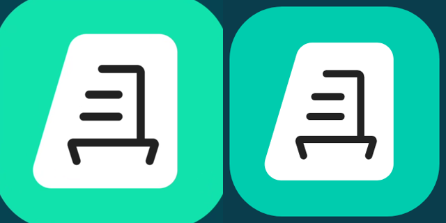

# Разбор ролика «Диадок, мобильное приложение» (34 с, 1920×1080, 25 fps)

Ролик собран нейросетью и получил критику. Ниже то, что видно по кадрам при сравнении
с официальными ассетами `s.kontur.ru` (скилл `kontur-design-system`).

## Что не так

1. **Иконка Диадока перерисована.** Слева кадр ролика (0:00.5), справа официальная
   `icons-products/diadoc/diadoc-256.svg`: другой цвет плашки, другие пропорции листа
   и толщина линий. Та же самодельная иконка повторяется в телефоне, в пушах и в финале.
   
2. **Цвета не из токенов и не совпадают между сценами.** Мятный фон `#11E2AC` в начале
   и `#10D2A1` в финале, тёмный фон `#064351`. По дизайн-системе для Диадока:
   `mint-normal-100 #00BEA2` (акцент) и `mint-normal-0 #004055` (дополнительный).
   Если в макете другие значения, ориентир — макет, но в пределах ролика цвет один.
3. **Финальный логотип «Контур Диадок» набран шрифтом**, а не взят файлом
   `logos/v2/diadoc/diadoc-32-dark.svg` (на акцентном фоне логотип целиком белый).
4. Скриншоты интерфейса и фото — проверить по макету, что это кадры оттуда,
   а не сгенерированные копии.

## Правила для следующих роликов

- Логотипы, иконки продуктов, UI-иконки, шрифт Kontur Sans берутся **только файлами**:
  из `s.kontur.ru` по каталогам скилла или экспортом из макета Figma. Ничего не
  перерисовывать в SVG/CSS, даже «похоже».
- Экраны приложения и фото: только экспорт из макета.
- Цвета: токены скилла либо точные значения из макета, одна палитра на ролик.
- Анимируется расположение/масштаб/прозрачность готовых ассетов, а не их форма.
